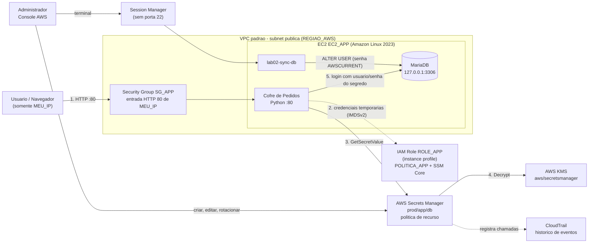
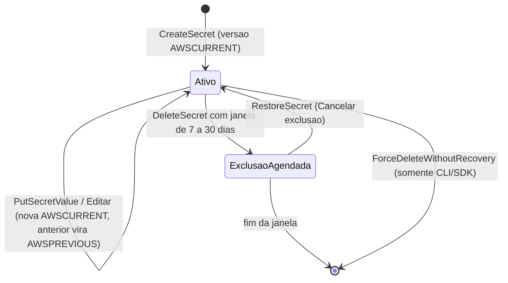

# AWS Secrets Manager — Credenciais de Banco sem Senha no Código: Arquitetura

> Laboratório **independente**: todos os recursos são criados do zero neste laboratório, sem depender de outros. Os nomes de recursos e os marcadores da sua conta estão descritos na seção **Nomes dos recursos** em [`IMPLANTACAO.md`](IMPLANTACAO.md).

> ✅ **Arquitetura implantada e validada.** O fluxo descrito abaixo foi executado de ponta a ponta: a EC2 obteve credenciais temporárias do IAM Role, leu o segredo via `GetSecretValue` (decifrado pelo KMS) e conectou ao MariaDB local com o usuário e a senha do segredo. As evidências estão em [`TESTES.md`](TESTES.md).

## Visão geral

A arquitetura demonstra o uso real de um segredo: a aplicação web **Cofre de Pedidos**, em uma **EC2 Linux**, precisa de usuário e senha para acessar um banco **MariaDB**. Em vez de gravar a senha no código, em arquivo de configuração ou no user data, a aplicação busca as credenciais no **AWS Secrets Manager** em tempo de execução.

- A EC2 recebe **credenciais temporárias** de um **IAM Role** associado por **instance profile**. Não existe chave de acesso estática na instância.
- O segredo `prod/app/db` fica **cifrado em repouso** pelo **AWS KMS**, com a chave gerenciada pela AWS `aws/secretsmanager`.
- O acesso ao segredo é controlado por duas camadas: a **política de identidade** do Role e a **política de recurso** do segredo.
- O banco MariaDB roda **na própria EC2**, escutando apenas em `127.0.0.1`. Assim o laboratório mostra o ciclo completo (segredo → conexão ao banco → rotação) sem o custo de um Amazon RDS.

## Diagrama da arquitetura de referência

## Fluxo de uma requisição

1. **Usuário → aplicação.** O navegador acessa `http://<IP_PUBLICO_EC2>/`. O Security Group `SG_APP` só aceita a porta 80 vinda de `<MEU_IP>`.
2. **Aplicação → IAM Role.** O SDK (`boto3`) obtém credenciais temporárias do Role `ROLE_APP` pelo serviço de metadados da instância (IMDSv2). Elas são renovadas automaticamente.
3. **Aplicação → Secrets Manager.** A aplicação chama `GetSecretValue` para `prod/app/db`. O Secrets Manager avalia a política de identidade do Role e a política de recurso do segredo.
4. **Secrets Manager → KMS.** Autorizada a leitura, o Secrets Manager pede ao KMS que decifre o valor com a chave `aws/secretsmanager` e devolve o JSON à aplicação.
5. **Aplicação → MariaDB.** A aplicação conecta ao banco com `username` e `password` do segredo, consulta a tabela `pedidos` e monta a página. A senha nunca aparece na página nem no log.

A aplicação mantém o segredo em **cache por 60 segundos**, para não chamar a API a cada requisição. Se o login no banco falhar com o valor em cache, ela relê o segredo uma vez antes de mostrar erro. É o mesmo padrão usado por aplicações reais depois de uma rotação.

## Componentes e decisões de configuração

### AWS Secrets Manager — segredo `prod/app/db`

- **Papel:** guardar as credenciais do banco, com versionamento.
- **Configuração:** tipo **Outro tipo de segredo**, com pares chave/valor: `engine`, `host`, `port`, `dbname`, `username` e `password`. É o mesmo formato que o Secrets Manager usa para segredos de bancos RDS.
- **Por quê:** a aplicação lê todos os dados de conexão em uma única chamada. Trocar a senha não exige alterar código nem reiniciar a aplicação.

### AWS KMS — chave `aws/secretsmanager`

- **Papel:** cifrar o valor do segredo em repouso e decifrá-lo apenas na leitura.
- **Configuração:** chave gerenciada pela AWS (padrão), sem custo de chave.
- **Por quê:** com a chave gerenciada, a política da chave já autoriza o uso **via Secrets Manager** para identidades da conta que podem ler o segredo. Por isso o Role **não precisa** de `kms:Decrypt`. Com uma chave do cliente (CMK), seria necessário conceder `kms:Decrypt` ao Role e ajustar a key policy.

### IAM Role `ROLE_APP` + instance profile

- **Papel:** dar à EC2 uma identidade com credenciais temporárias.
- **Configuração:** entidade confiável `ec2.amazonaws.com`, com duas políticas de finalidades distintas:
  - `POLITICA_APP` (gerenciada pelo cliente): **somente** `secretsmanager:GetSecretValue` no **ARN do segredo**, sem curingas na ação.
  - `AmazonSSMManagedInstanceCore` (gerenciada pela AWS): permite o acesso ao terminal pelo **Session Manager**, sem abrir a porta 22.
- **Por quê:** menor privilégio. O Role não lista segredos, não lê outros segredos e não altera nada no Secrets Manager.

### Política de recurso do segredo

- **Papel:** segunda camada de controle, anexada ao próprio segredo.
- **Configuração:** um `Deny` em `secretsmanager:GetSecretValue` para qualquer principal **fora** de uma lista: o Role da aplicação e o administrador do laboratório.
- **Por quê:** mesmo que outra identidade da conta receba, por engano, uma política com `secretsmanager:*`, o `Deny` explícito do segredo prevalece. A regra bloqueia apenas a leitura do valor, então o administrador continua podendo editar ou remover a política de recurso.

### EC2 `EC2_APP` (Amazon Linux 2023)

- **Papel:** executar a aplicação e o banco local.
- **Configuração:** `t3.micro`, subnet pública com IP público, IMDSv2 obrigatório, Role `ROLE_APP` associado **na criação** e o script [`app/user-data.sh`](app/user-data.sh) como user data. O script instala:
  - o MariaDB, escutando apenas em `127.0.0.1`;
  - a aplicação Python, rodando como o usuário sem privilégios `lab02app`;
  - o utilitário `lab02-sync-db`.
- **Por quê:** o user data não contém senha. No boot, ele próprio lê o segredo pelo Role e cria o usuário do banco com essa senha. A credencial existe só no Secrets Manager e no banco.

### Banco MariaDB local

- **Papel:** o "sistema de destino" da credencial.
- **Configuração:** banco `lab02db` com a tabela `pedidos`, contendo 3 linhas fictícias. O usuário `app_user` tem apenas `SELECT`.
- **Por quê:** permite observar o efeito real de uma rotação: a senha muda no segredo, mas o banco só aceita a nova depois de ser atualizado.

### Utilitário `lab02-sync-db`

- **Papel:** aplicar no banco a senha da versão `AWSCURRENT` do segredo.
- **Por quê:** simula manualmente o que uma **função Lambda de rotação** faz automaticamente (etapas `setSecret` e `finishSecret`).

### Security Group `SG_APP`

- **Entrada:** apenas **HTTP 80** de `<MEU_IP>/32`. Sem SSH (22) e sem 3306.
- **Saída:** padrão (tudo liberado), necessária para alcançar os endpoints do Secrets Manager, do SSM e os repositórios de pacotes.
- **Por quê:** a aplicação fica visível só para quem faz o laboratório, e o banco nunca fica exposto.

### Session Manager e CloudTrail

- **Session Manager:** terminal na EC2 pelo Console, autenticado pelo IAM e sem porta aberta.
- **CloudTrail (histórico de eventos):** registra `GetSecretValue`, `PutSecretValue` e o `Decrypt` feito pelo Secrets Manager no KMS. É a evidência de quem leu o segredo e quando. O histórico de eventos de 90 dias é gratuito e não exige criar uma trilha.

## Ciclo de vida do segredo

| Estágio | Significado |
|---------|-------------|
| `AWSCURRENT` | Versão atual, retornada por padrão em `GetSecretValue`. |
| `AWSPREVIOUS` | Versão imediatamente anterior, útil para rollback. |
| `AWSPENDING` | Versão em preparação durante uma rotação automática, antes de ser promovida. |

## Rotação: manual (prática) × automática (conceitual)

| Etapa da rotação automática (Lambda) | Equivalente manual neste laboratório |
|--------------------------------------|--------------------------------------|
| `createSecret`: gera a nova senha como `AWSPENDING` | Editar o valor do segredo no Console (já vira `AWSCURRENT`) |
| `setSecret`: altera a senha no banco | `sudo lab02-sync-db` via Session Manager |
| `testSecret`: testa o login com a nova senha | Recarregar a aplicação e ver o cartão do banco **OK** |
| `finishSecret`: promove `AWSPENDING` a `AWSCURRENT` | Já ocorreu na edição (por isso há uma janela de falha) |

Na rotação manual há um intervalo em que o segredo já tem a senha nova e o banco ainda tem a antiga. A aplicação falha nesse intervalo. A rotação automática evita essa janela porque só promove a nova versão depois de alterar e testar a senha no banco. Para Amazon RDS e Aurora, a AWS oferece rotação gerenciada, sem escrever a Lambda.

## O que não é provisionado

- **Função Lambda de rotação:** apenas conceitual.
- **Chave KMS do cliente (CMK):** citada como alternativa, com custo mensal por chave.
- **VPC endpoint (interface) do Secrets Manager:** boa prática para subnets privadas sem saída à internet. Tem custo por hora e não é necessário aqui, porque a EC2 está em subnet pública.
- **Amazon RDS:** substituído pelo MariaDB local, para manter o custo baixo.
